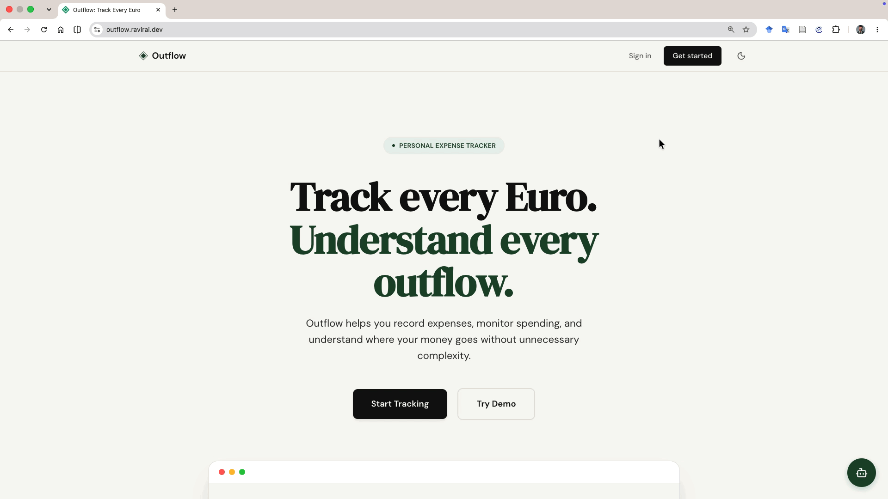
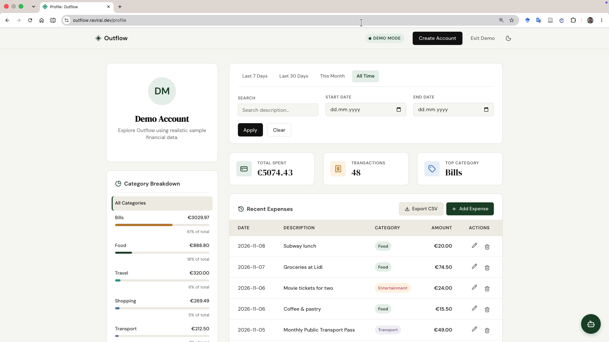
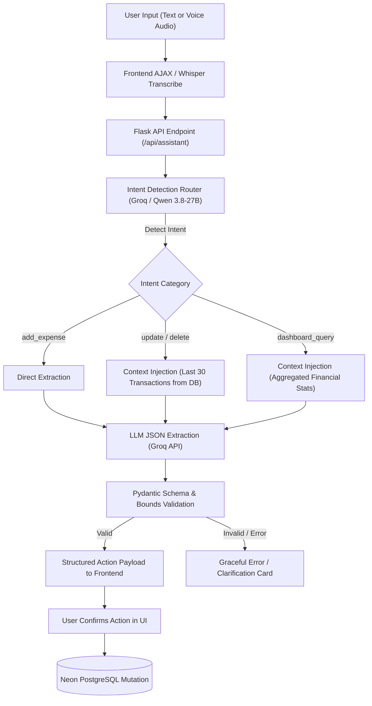

# Outflow

[](https://www.python.org)
[](https://flask.palletsprojects.com/)
[](https://groq.com/)
[](https://github.com/openai/whisper)
[](https://docs.pydantic.dev/)
[](https://neon.tech)
[](https://www.postgresql.org/)
[](https://alembic.sqlalchemy.org/)
[](https://gunicorn.org/)
[](https://www.docker.com/)
[](https://outflow.onrender.com/)
[](https://azure.microsoft.com/)
[](https://github.com/theravirai/outflow/actions/workflows/ci-cd.yml)

Outflow is an AI-powered financial assistant and personal expense tracker. It combines low-latency open-source LLMs (`qwen/qwen3.8-27b` via Groq), Whisper voice transcription, and strict Pydantic schema validation with a robust PostgreSQL and Flask backend.

**[🌐 View Live Demo](https://outflow.onrender.com/)**

> [!NOTE]
> **Live Demo Availability:** The application is currently hosted on **Render** backed by a **Neon PostgreSQL** database. Because Render spins down free-tier instances after periods of inactivity, the **initial page load may take ~30–50 seconds to cold-start**. Once awake, subsequent requests run with normal low latency. *(The application was previously hosted on Microsoft Azure App Service & ACR, and was migrated to Render to maintain zero ongoing cloud costs).*

<p align="center">
  
</p>

## Table of Contents
- [Features](#features)
- [Technology Stack](#technology-stack)
- [Architecture Overview](#architecture-overview)
- [Project Structure](#project-structure)
- [Installation & Setup](#installation--setup)
- [Testing](#testing)
- [Deployment](#deployment)

---

## Features

- **AI Assistant:** A conversational assistant that categorizes expenses, updates entries, deletes transactions, and answers spending queries.
- **Voice-to-Text Input:** Records audio via the browser's MediaRecorder API and transcribes it using Whisper.
- **Conversational Context & State Updates:** Enables multi-turn corrections (e.g., *"Sorry, the expense was 18 euros, not 25"*) and direct financial queries (*"Show me recent transactions"*) without manual navigation.

<p align="center">
  
</p>

- **Expense Tracking:** Logs expenditures with fields for amount, category, date, and description.
- **Dynamic Date Filtering:** Filters transaction history using presets (7 Days, 30 Days, This Month, All Time) or custom date ranges.
- **Financial Dashboard:** Displays total spending, total transactions, and the primary category driving expenditure.
- **CSV Data Export:** One-click download of all user expense records formatted for external analysis.
- **Demo Mode:** A sandbox environment populated with realistic mock data. Demo data seamlessly transitions to a real account upon registration.
- **Security & Rate Limiting:** Endpoint protection via Flask-Limiter throttling (20 req/min on AI endpoints, 5 req/min on auth), CSRF token interception, and salted password hashing.
- **Dark Mode:** Toggleable dark theme with system preference auto-detection.

---

## Architecture Overview

Outflow follows a clean, monolithic client-server architecture designed for rapid Server-Side Rendering (SSR) without the overhead of heavy JavaScript build pipelines.

*   **Frontend (Vanilla SSR):** Pre-rendered HTML generated by Jinja2, utilizing vanilla CSS and lightweight Vanilla JavaScript for localized dynamic components (e.g., the AI Chat Panel and AJAX data filtering).
*   **Backend (Flask & Gunicorn):** A single file routing monolithic Flask backend (`app.py`) handles all core logic, session security, and Jinja2 templating. In production on Azure, it is served concurrently via Gunicorn.
*   **Database (Neon PostgreSQL):** All data is stored in a Neon Postgres database. Queries are securely executed using `psycopg2` parameterized raw SQL bypassing heavy ORMs for absolute query performance and transparency, while Alembic handles migrations.
*   **AI Services (Groq & Whisper):** The backend decoupled service layer securely processes and forwards natural language to the Groq API (`qwen/qwen3.8-27b` by default, configurable via `GROQ_MODEL`) and audio to Whisper (`whisper-large-v3`), translating conversational commands into structured JSON actions.

### AI Assistant Pipeline & Guardrails

The conversational layer is decoupled from direct database mutation. User inputs are categorized into strict intents, verified through context injection, and passed through Pydantic schemas before any state changes occur:



---

## Technology Stack

- **Backend:** Python, Flask, Gunicorn
- **Database:** PostgreSQL, Alembic (migrations), psycopg2 (raw SQL queries)
- **Frontend:** HTML5, Jinja2, Vanilla JavaScript, Vanilla CSS
- **AI & NLP:** Groq API (`qwen/qwen3.8-27b`), Whisper (`whisper-large-v3`), Pydantic
- **Infrastructure & Deployment:** Docker, Render, Neon PostgreSQL, Microsoft Azure (App Service & ACR), GitHub Actions CI/CD
- **Testing:** Pytest

---

## Project Structure

```text
outflow/
├── alembic/                # Database migration scripts
├── database/               # Data access layer (connection pooling, SQL queries)
├── docs/                   # Detailed engineering documentation
├── services/               # Business logic (AI intent routing and parsing)
├── static/                 # Frontend assets (Vanilla CSS and JavaScript)
├── templates/              # Server-side rendered Jinja2 HTML templates
├── tests/                  # Pytest unit and integration test suite
├── .github/workflows/      # GitHub Actions CI/CD pipelines
├── app.py                  # Core Flask application and routing
├── docker-compose.yml      # Local container orchestration
└── Dockerfile              # Production image definition
```

---

## Installation & Setup

### Prerequisites
- Python 3.13+
- PostgreSQL
- [Groq API Key](https://console.groq.com/)

### 1. Clone the repository
```bash
git clone https://github.com/theravirai/outflow.git
cd outflow
```

### 2. Environment Setup
```bash
python -m venv venv
source venv/bin/activate  # On Windows: venv\Scripts\activate
pip install -r requirements.txt
```

### 3. Configuration
Copy the example environment file:
```bash
cp .env.example .env
```
Edit `.env` and set the required variables:
- `DATABASE_URL`: Connection string for your development database (e.g. Neon or local PostgreSQL).
- `DATABASE_URL_TEST`: Connection string for the isolated test database.
- `GROQ_API_KEY`: API key for the AI assistant and voice transcription.
- `GROQ_MODEL`: Model identifier on Groq (defaults to `qwen/qwen3.8-27b`).
- `SECRET_KEY`: Cryptographic key for Flask sessions.

### 4. Database Migrations
Apply the database schema using Alembic:
```bash
alembic upgrade head
```

### 5. Run the Application
```bash
python app.py
```
The application will be available at `http://localhost:5001`.

---

## Testing

The test suite runs against an isolated PostgreSQL sandbox database specified by `DATABASE_URL_TEST`. It automatically handles test schema creation and rollback.

Run all tests:
```bash
pytest
```

---

## Deployment

Outflow is containerized with Docker and hosted on **Render** backed by a **Neon PostgreSQL** database.

The repository also includes a production-ready GitHub Actions CI/CD pipeline (`.github/workflows/ci-cd.yml`) that was previously used for automated builds, tagging, and deployments to **Microsoft Azure App Service** via Azure Container Registry (ACR). The production hosting was migrated to Render to maintain a 100% free, zero-cost setup for public portfolio demonstration.

For comprehensive architectural and container deployment instructions, read the [Deployment Architecture Guide](docs/10-deployment.md).
